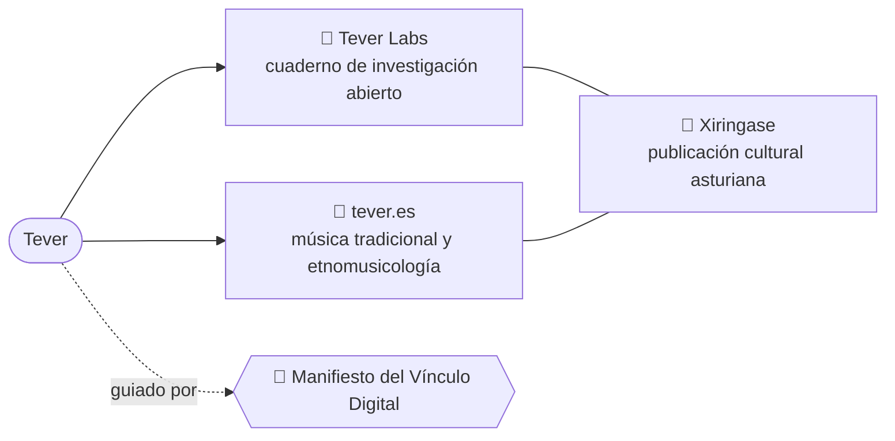
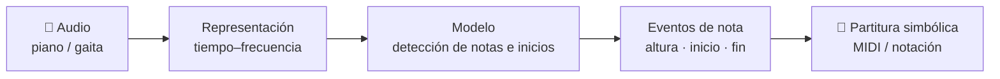
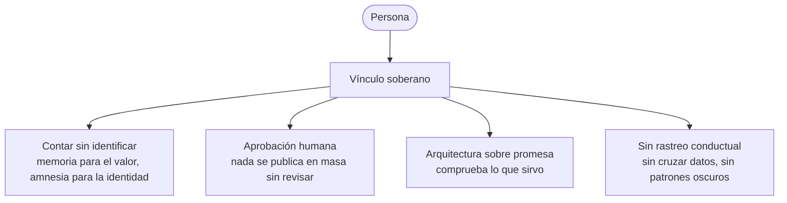

# Hola, soy Tever 👋

**Investigador independiente en informática musical · Gaitero asturiano · Docente**

[English](README.md) · [Español](README.es.md)

---

## 👤 Sobre mí

Ingeniero Informático desde 2010, vivo en Asturies. Trabajo donde la
**música tradicional se cruza con la tecnología**.

Mi línea principal es la **Transcripción Automática de Música (AMT)** —en
especial la transcripción polifónica de piano— dentro de la **Recuperación de
Información Musical (MIR)** y las **Humanidades Digitales**, con la gaita
asturiana como interés aparte. Es el tema de mi investigación doctoral en curso.

Publico **a la vista**: notas de campo, prototipos, código y errores incluidos.
Lo que aún no tiene material publicable se marca como tal: el silencio también
es un dato.

## 🧭 Dónde vive mi trabajo

## 🔬 Línea de investigación

Un pipeline típico de AMT, la forma del problema en el que trabajo:

## 🤝 Vínculo Digital

Desarrollo software bajo el
[**Manifiestu del Vínculu Dixital**](https://xiringase.com/manifiestu)
(octubre de 2026): la persona que usa lo que hago es **un socio, no una métrica**.

## 📫 Contacto

Email [hola@tever.es](mailto:hola@tever.es) · Web [tever.es](https://tever.es/?utm=github) · Investigación [labs.tever.es](https://labs.tever.es)
