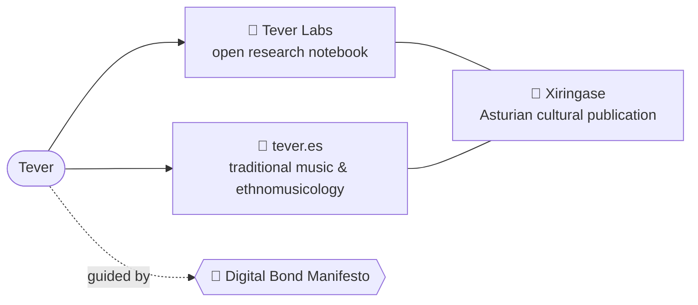
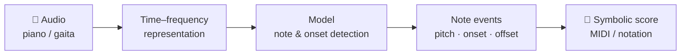
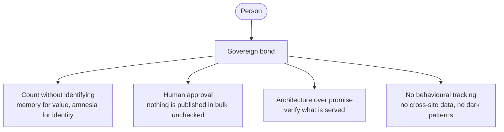

# Hi, I'm Tever 👋

**Independent researcher in music informatics · Asturian bagpiper · Educator**

[English](README.md) · [Español](README.es.md)

---

## 👤 About

Software engineer since 2010, based in Asturies (Spain). I work where
**traditional music meets technology**.

My main line is **Automatic Music Transcription (AMT)** — polyphonic piano
transcription in particular — within **Music Information Retrieval (MIR)** and
**Digital Humanities**, with the Asturian bagpipe (*gaita*) as a separate
interest. This is the subject of my ongoing PhD research.

I publish **in the open**: field notes, prototypes, code and mistakes included.
What has no publishable material yet is marked as such — silence is data too.

## 🧭 Where my work lives

## 🔬 Research focus

A typical AMT pipeline — the shape of the problem I work on:

## 🤝 Digital Bond

I build software under the
[**Manifesto of the Digital Bond**](https://xiringase.com/manifiestu)
(*Manifiestu del Vínculu Dixital*, October 2026): the person using what I make
is **a partner, not a metric**.

## 📫 Contact

Email [hola@tever.es](mailto:hola@tever.es) · Web [tever.es](https://tever.es/?utm=github) · Research [labs.tever.es](https://labs.tever.es)
